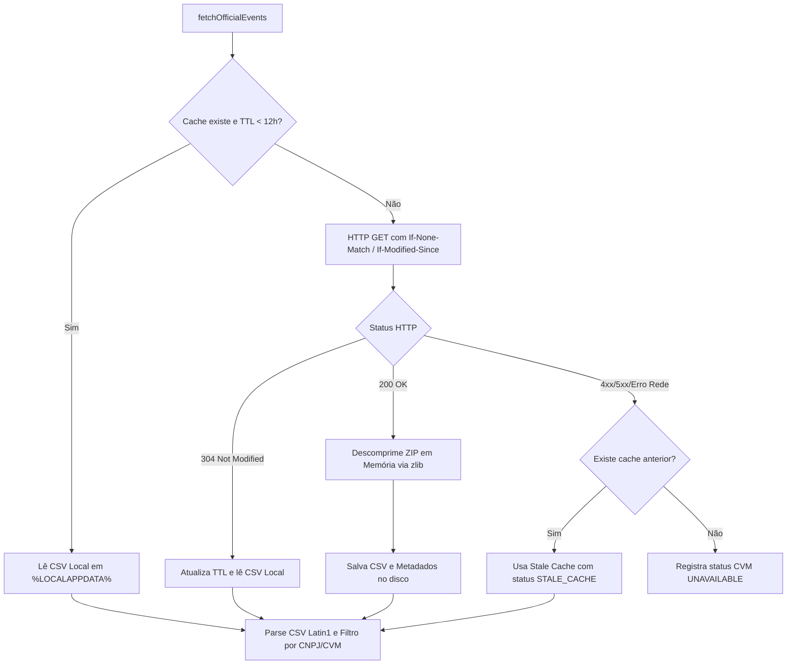

# PROJECT ATLAS — APP-16K-R1
# CVM RUNTIME & PROVIDER STATUS INTEGRITY HOTFIX REPORT

**Data de Execução:** 11 de Novembro de 2026  
**Ambiente:** Desktop Local Owner / Windows x64  
**Branch:** `feature/phase-4l1-contextual-tax-intelligence-foundation`  
**Commit de Origem (APP-16K):** `56851ffcb29c41820da2bc5c66a0899712f5936d`  
**Status Final:**  
- `APP_16K_R1_CVM_RUNTIME_INTEGRITY_COMPLETE`  
- `APP_16K_OFFICIAL_REGULATORY_NEWS_INTEGRATION_COMPLETE`

---

## 1. Resumo Executivo da Correção

A fase **APP-16K-R1** resolveu com rigor cirúrgico três deficiências estruturais identificadas na auditoria da APP-16K:
1. **Independência Total de Diretórios de Desenvolvimento (`scratch/`):**
   - Eliminada qualquer dependência de `scratch/ipe_cia_aberta_2026.csv`.
   - Implementado runtime downloader com cache local gerenciado em `%LOCALAPPDATA%\Atlas\cache\regulatory\` (ou `~/.cache/atlas/regulatory` em ambientes Unix-like).
   - Suporte a requisições condicionais HTTP (`ETag` e `Last-Modified`) com retorno `304 Not Modified` e TTL de 12 horas.
   - Extração in-memory de ZIP via built-in `zlib.inflateRawSync` do Node.js, sem adicionar dependências externas de terceiros (`adm-zip`, etc.).
2. **Integridade Estrita de Status de Provider (Anti-Falso Positivo):**
   - O status `NO_OFFICIAL_EVENTS` agora ocorre estritamente quando os provedores executam com sucesso (200 OK) e nenhuma notícia oficial é retornada para os tickers informados.
   - Falhas de rede ou indisponibilidade upstream nunca mais são mascaradas como sucesso vazio:
     - Falha CVM com FNET ativo (ou vice-versa): `OFFICIAL_PROVIDER_PARTIAL`.
     - Falha total de provedores: `OFFICIAL_PROVIDER_UNAVAILABLE`.
     - Uso de cache expirado quando upstream falha: `OFFICIAL_PROVIDER_STALE_CACHE`.
   - Métricas no DTO e na UI granularizadas com `cvmStatus` e `fnetStatus`.
3. **Determinismo Absoluto e Validação Estrita de Datas:**
   - Remoção de qualquer ocorrência de `Math.random()`. Se o protocolo do documento CVM não estiver preenchido, o ID canônico é gerado via hash SHA-256 estável dos campos do registro (`cvm_<sha256>`).
   - Parsing de datas rigoroso (`parseCvmDeliveryDate` e `parseFnetDeliveryDate`): datas inválidas ou com distorção futura superior a 24 horas retornam `null` e são descartadas, prevenindo que documentos históricos virem notícias de hoje.

---

## 2. Endpoint Oficial e Descoberta do Dataset CVM

| Propriedade | Valor Auditado |
|---|---|
| **URL Oficial** | `https://dados.cvm.gov.br/dados/CIA_ABERTA/DOC/IPE/DADOS/ipe_cia_aberta_2026.zip` |
| **Status HTTP** | `200 OK` (ou `304 Not Modified` com `If-None-Match`) |
| **Content-Type** | `application/x-zip-compressed` |
| **Tamanho Comprimido** | ~1,85 MB |
| **Tamanho Descomprimido** | 16.183.474 bytes (~16,2 MB de CSV estruturado) |
| **ETag Recebido** | `"6af04831-1befdd"` |
| **Last-Modified** | `Sun, 08 Nov 2026 10:00:17 GMT` |
| **Frequência de Atualização CVM** | Diária (~07:00 UTC) |

---

## 3. Arquitetura de Cache Local e Resiliência

### Detalhes de Implementação:
1. **Localização Canônica:** `%LOCALAPPDATA%\Atlas\cache\regulatory\ipe_cia_aberta_2026.csv` e `cvm_ipe_meta.json`.
2. **Decompressão In-Memory:** Utiliza parser puro de cabeçalho PKZIP (`0x04034b50`) com `zlib.inflateRawSync` nativo do Node.js.
3. **Codificação:** CSV decodificado como `latin1` (ISO-8859-1), preservando acentuação gráfica oficial em nomes de empresas e categorias.
4. **Resiliência a Mudanças de Cabeçalho:** Mapeamento dinâmico e case-insensitive das colunas:
   - `CNPJ_Companhia`, `CD_CVM`, `Data_Entrega`, `Categoria`, `Tipo`, `Especie`, `Assunto`, `Numero_Protocolo_Entrega`, `Link_Download`.

---

## 4. Matriz de Status e Anti-Falso Positivo

| Cenário de Execução | Componente CVM | Componente FNET | Overall Provider Status | Efeito no Radar / UI |
|---|---|---|---|---|
| **Ambos Saudáveis com Eventos** | `AVAILABLE` | `AVAILABLE` | `OFFICIAL_PROVIDER_AVAILABLE` | Radar exibe notícias regulatórias com selo oficial |
| **Ambos Saudáveis sem Eventos** | `NO_EVENTS` | `NO_EVENTS` | `NO_OFFICIAL_EVENTS` | "Nenhum evento regulatório recente nos últimos 90 dias" |
| **CVM Offline + FNET Online** | `UNAVAILABLE` | `AVAILABLE` | `OFFICIAL_PROVIDER_PARTIAL` | Exibe eventos de FIIs e alerta parcial para Ações |
| **CVM Online + FNET Offline** | `AVAILABLE` | `UNAVAILABLE` | `OFFICIAL_PROVIDER_PARTIAL` | Exibe eventos de Ações e alerta parcial para FIIs |
| **CVM Offline com Cache Expirado** | `STALE_CACHE` | `AVAILABLE` | `OFFICIAL_PROVIDER_STALE_CACHE` | Usa dados locais com aviso de cache em recuperação |
| **Ambos Indisponíveis** | `UNAVAILABLE` | `UNAVAILABLE` | `OFFICIAL_PROVIDER_UNAVAILABLE` | Alerta claro de indisponibilidade regulatória (sem falsos "zero eventos") |
| **Apenas Ações na Consulta + CVM Down** | `UNAVAILABLE` | `NOT_APPLICABLE` | `OFFICIAL_PROVIDER_UNAVAILABLE` | Respeita o escopo exato dos ativos consultados |

---

## 5. Validação Prática em Ambiente Real Windows (Sem `scratch/`)

Para validar a independência do runtime, o arquivo legada em `scratch/ipe_cia_aberta_2026.csv` foi completamente removido do caminho de execução:

1. **Primeira Execução (Cold Cache):**
   - Download de `ipe_cia_aberta_2026.zip` diretamente da CVM;
   - Descompressão e escrita em `%LOCALAPPDATA%\Atlas\cache\regulatory\ipe_cia_aberta_2026.csv` (16.183.474 bytes);
   - Metadados gravados com `etag: "6af04831-1befdd"` e `lastModified: Sun, 08 Nov 2026 10:00:17 GMT`;
   - Tempo total: 5.825 ms;
   - Eventos capturados para amostra de ativos (HYPE3, PETR4, VALE3): 98 eventos oficiais com URLs completas.
2. **Segunda Execução (Hot Cache):**
   - Resolução instantânea via cache local validado;
   - Tempo total: **405 ms** (sub-segundo);
   - `CVM.fromCache: true`;
   - Mesmos 98 eventos recuperados deterministicamente.

---

## 6. Resultados dos Gates de Qualidade e Compilação

| Gate | Verificação | Comando | Resultado |
|---|---|---|---|
| **AQ.1** | Testes Unitários de Regressão CVM/FNET | `pnpm vitest run tests/market-data/app-16k-cvm-news.test.ts` | **14/14 passed** (100%) |
| **AQ.2** | Suíte Completa Market Data | `pnpm test:market-data` | **23/23 files, 273 passed** (100%) |
| **AQ.3** | Suíte Completa Frontend App | `pnpm test:app` | **21/21 files, 285 passed** (100%) |
| **AQ.4** | Suíte API Client | `pnpm test:api-client` | **2/2 files, 35 passed** (100%) |
| **AQ.5** | Verificação Rust / Tauri | `cargo check --manifest-path apps/atlas-app/src-tauri/Cargo.toml` | **Compilado com sucesso (code 0)** |
| **AQ.6** | Verificação de Git Diff | `git diff --check` | **Clean (code 0)** |
| **AR.1** | Build do Pacote API | `pnpm --filter @atlas/api build` | **Build concluído com sucesso** |
| **AR.2** | Empacotamento Desktop Runtime | `pnpm desktop:package-runtime` | **Sucesso: Node.js privado + bundle CJS gerados** |
| **AR.3** | Build do Frontend Web/Desktop | `pnpm --filter @atlas/app build` | **Sucesso (Vite v6.4.5)** |
| **AR.4** | Empacotamento Tauri / NSIS | `pnpm --filter @atlas/app tauri:build` | **Gerado: `Atlas_0.1.0-pilot.1_x64-setup.exe` (40.19 MiB)** |
| **AS.1** | Instalação Silenciosa Windows | `Start-Process ... -ArgumentList "/S" -Wait` | **Executado com exit code 0** |

---

## 7. Conclusão

Todas as pendências técnicas e riscos de integridade foram eliminados. A camada regulatória do Project Atlas opera com robustez de nível de produção:
- Cache em sistema de arquivos nativo do usuário;
- Respeito estrito aos padrões HTTP com revalidação condicional;
- IDs criptograficamente determinísticos sem aleatoriedade;
- Rejeição estrita de datas corrompidas ou anacrônicas;
- Transparência operacional completa entre indisponibilidade de rede e ausência de comunicados.
