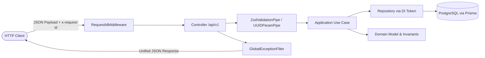

# API Architecture — Project Atlas

## 1. Visão Geral

A camada HTTP do **Project Atlas** é implementada em `apps/api` utilizando o framework **NestJS 11**.
Sua responsabilidade primária é expor uma interface RESTful padronizada, versionada (`/api/v1`), validada por schemas rigorosos e documentada via OpenAPI 3.0, conectando as requisições dos clientes (mobile e web) aos casos de uso de aplicação e aos repositórios de persistência do `@atlas/database`.

---

## 2. Fluxo de Execução da Arquitetura



1. **RequestIdMiddleware:** Preserva ou gera o header `x-request-id` para rastreamento ponta a ponta.
2. **Controller:** Trata o roteamento HTTP, anotações OpenAPI (Swagger) e códigos de status.
3. **Pipes de Validação:** `ZodValidationPipe` aplica os schemas do `@atlas/validation`. Rejeita números de ponto flutuante em campos financeiros e valida datas de calendário.
4. **Application Use Case:** Executa a orquestração do negócio de forma isolada do protocolo HTTP.
5. **Repositories:** Injetados via Dependency Injection usando tokens desacoplados (`Symbol('..._REPOSITORY')`).
6. **GlobalExceptionFilter:** Captura qualquer exceção lançada no pipeline e serializa um envelope de erro previsível e seguro.

---

## 3. Estrutura de Diretórios (`apps/api`)

```text
apps/api/src/
├── application/                     # Casos de uso de aplicação (puros, sem HTTP)
│   ├── portfolios/                  # Create, Get, List portfolios
│   ├── institutions/                # Create, Get, List institutions
│   ├── accounts/                    # Create, Get, List accounts
│   ├── assets/                      # Create, Get, Search assets
│   ├── transactions/                # Create, Get, List transactions
│   ├── application.module.ts        # Módulo NestJS agrupando todos os use cases
│   └── index.ts
├── common/                          # Utilitários compartilhados da camada HTTP
│   ├── errors/                      # Not-found e reexportações de erros de banco
│   ├── filters/                     # GlobalExceptionFilter
│   ├── middleware/                  # RequestIdMiddleware
│   └── pipes/                       # ZodValidationPipe, UUIDParamPipe
├── database/                        # Wiring de injeção de dependência dos repositórios
│   ├── database.module.ts           # Provedores globais de repositórios
│   ├── tokens.ts                    # Símbolos de injeção (PORTFOLIO_REPOSITORY, etc.)
│   └── index.ts
├── health/                          # Probes de liveness e readiness
│   ├── health.controller.ts         # GET /health e GET /ready
│   ├── health.controller.spec.ts    # Testes unitários do controller
│   └── health.module.ts
├── modules/                         # Módulos HTTP do NestJS (Controllers e DTOs)
│   ├── portfolios/                  # PortfoliosController, DTOs Swagger
│   ├── institutions/                # InstitutionsController, DTOs Swagger
│   ├── accounts/                    # AccountsController, PortfolioAccountsController
│   ├── assets/                      # AssetsController, DTOs Swagger
│   └── transactions/                # TransactionsController, PortfolioTransactionsController
├── app.module.ts                    # Root AppModule com middlewares e módulos
└── main.ts                          # Bootstrap do servidor, CORS, Swagger e filtros
```

---

## 4. Contratos de Rotas e Endpoints

### 4.1. Probes de Infraestrutura (Raiz)

| Método | Endpoint     | Descrição                                          | Resposta de Sucesso                                                 |
| :----- | :----------- | :------------------------------------------------- | :------------------------------------------------------------------ |
| `GET`  | `/health`    | Liveness probe (verifica se o processo está no ar) | `200 OK` `{ status: 'ok', service: 'atlas-api', version: '0.1.0' }` |
| `GET`  | `/ready`     | Readiness probe (executa `SELECT 1` no PostgreSQL) | `200 OK` `{ status: 'ok', database: 'connected' }`                  |
| `GET`  | `/docs`      | Documentação interativa Swagger UI                 | `200 OK` (HTML)                                                     |
| `GET`  | `/docs-json` | Especificação OpenAPI 3.0 completa                 | `200 OK` (JSON)                                                     |

### 4.2. Recursos de Domínio (`/api/v1`)

#### Portfolios

- `POST /api/v1/portfolios`: Cria carteira de investimentos (suporta `PERSONAL`, `FAMILY`, `COMPANY`, `SIMULATION`).
- `GET /api/v1/portfolios?userId=:userId`: Lista todas as carteiras pertencentes ao usuário.
- `GET /api/v1/portfolios/:portfolioId`: Obtém detalhes de uma carteira específica.

#### Institutions

- `POST /api/v1/institutions`: Registra nova instituição financeira (`BANK`, `BROKER`, `CRYPTO_EXCHANGE`, `OTHER`).
- `GET /api/v1/institutions`: Lista instituições financeiras cadastradas.
- `GET /api/v1/institutions/:institutionId`: Obtém detalhes de uma instituição específica.

#### Accounts

- `POST /api/v1/portfolios/:portfolioId/accounts`: Cria conta de custódia vinculada à carteira e instituição.
- `GET /api/v1/portfolios/:portfolioId/accounts`: Lista todas as contas de custódia da carteira.
- `GET /api/v1/accounts/:accountId`: Obtém detalhes de uma conta específica.

#### Assets

- `POST /api/v1/assets`: Registra ativo negociável (`STOCK`, `FII`, `ETF`, `BDR`, `FIXED_INCOME`, `TREASURY`, etc.).
- `GET /api/v1/assets?q=:query&exchange=:exchange&type=:type`: Busca e filtra ativos por ticker, nome, bolsa ou classe.
- `GET /api/v1/assets/:assetId`: Obtém detalhes do ativo por ID único.

#### Transactions (Append-Only Ledger)

- `POST /api/v1/portfolios/:portfolioId/transactions`: Insere um novo evento imutável no ledger financeiro.
  - Suporta todos os tipos de transação: `BUY`, `SELL`, `DIVIDEND`, `JCP`, `FII_INCOME`, `SPLIT`, `REVERSE_SPLIT`, `BONUS`, `SUBSCRIPTION`, `AMORTIZATION`, `TRANSFER_IN`, `TRANSFER_OUT`, `DEPOSIT`, `WITHDRAWAL`, `FEE`, `TAX`.
  - Exige estritamente strings decimais para valores financeiros (`quantity`, `unitPrice`, `amount`, etc.).
  - Valida data econômica de calendário (`tradeDate`).
- `GET /api/v1/portfolios/:portfolioId/transactions`: Consulta o histórico ordenado determinística (`tradeDate ASC, createdAt ASC, id ASC`) com paginação por cursor (`limit`, `cursor`) e filtros opcionais (`accountId`, `assetId`, `type`, `startDate`, `endDate`).
- `GET /api/v1/transactions/:transactionId`: Obtém uma transação específica por ID.
- **PROIBIDO:** Métodos `PUT`, `PATCH` ou `DELETE` para transações retornam `404 Not Found`.

---

## 5. Envelope de Resposta e Tratamento de Erros

### 5.1. Resposta de Sucesso Padrão

```json
{
  "data": {
    "id": "11111111-1111-4111-8111-111111111111",
    "name": "Carteira Principal",
    "baseCurrency": "BRL",
    "type": "PERSONAL",
    "status": "ACTIVE",
    "createdAt": "2026-09-15T21:00:00.000Z",
    "updatedAt": "2026-09-15T21:00:00.000Z"
  }
}
```

### 5.2. Resposta de Paginação por Cursor

```json
{
  "data": [ ... ],
  "meta": {
    "limit": 50,
    "cursor": "22222222-2222-4222-8222-222222222222",
    "nextCursor": "33333333-3333-4333-8333-333333333333",
    "hasMore": true
  }
}
```

### 5.3. Resposta de Erro Unificada

```json
{
  "statusCode": 400,
  "error": "Bad Request",
  "code": "VALIDATION.INVALID_INPUT",
  "message": "Request validation failed",
  "details": [
    {
      "path": "quantity",
      "message": "Expected string, received number",
      "code": "invalid_type"
    }
  ],
  "timestamp": "2026-09-15T21:00:00.000Z",
  "path": "/api/v1/portfolios/11111111-1111-4111-8111-111111111111/transactions",
  "requestId": "a1b2c3d4-e5f6-4a7b-8c9d-0e1f2a3b4c5d"
}
```

### 5.4. Tabela de Mapeamento de Exceções

| Exceção                             | HTTP Status                 | Código de Erro                        | Descrição                                    |
| :---------------------------------- | :-------------------------- | :------------------------------------ | :------------------------------------------- |
| `ZodError`                          | `400 Bad Request`           | `VALIDATION.INVALID_INPUT`            | Falha de validação estrutural do schema      |
| `DomainError`                       | `400 Bad Request`           | `DOMAIN.*`                            | Violação de invariante de negócio financeiro |
| `EntityNotFoundError`               | `404 Not Found`             | `*.NOT_FOUND`                         | Recurso solicitado não existe no banco       |
| `CrossPortfolioIntegrityError`      | `409 Conflict`              | `PORTFOLIO.CROSS_PORTFOLIO_VIOLATION` | Conta não pertence à carteira informada      |
| `DuplicateExternalTransactionError` | `409 Conflict`              | `TRANSACTION.DUPLICATE_EXTERNAL_ID`   | Operação externa já importada na carteira    |
| `PersistenceError`                  | `500 Internal Server Error` | `PERSISTENCE.ERROR`                   | Erro inesperado na camada de banco de dados  |
| `Error` (desconhecido)              | `500 Internal Server Error` | `INTERNAL_SERVER_ERROR`               | Falha interna não tratada                    |

---

## 6. Rastreabilidade e Segurança nos Logs

- Todo fluxo HTTP é identificado por um `x-request-id`. Clientes podem enviar seu próprio header de rastreamento ou o middleware gera um UUID v4.
- O header `x-request-id` é exposto no CORS (`exposedHeaders: ['x-request-id']`).
- **Sanitização de Logs:** O `GlobalExceptionFilter` registra apenas dados de diagnóstico essenciais (`timestamp`, `requestId`, `method`, `url`, `statusCode`, `code`, `message`).
- **Nenhum corpo de requisição, dado financeiro, saldo, token ou senha é registrado em log.**

---

## 7. Estratégia de Testes

Os testes da API são executados via Vitest com `supertest` no ambiente de banco real PostgreSQL (`atlas_test`):

```bash
# Executa apenas a suite de integração da API
pnpm test:api

# Executa todas as suites de testes do repositório (unitários, banco, api, fundação)
pnpm test
```
