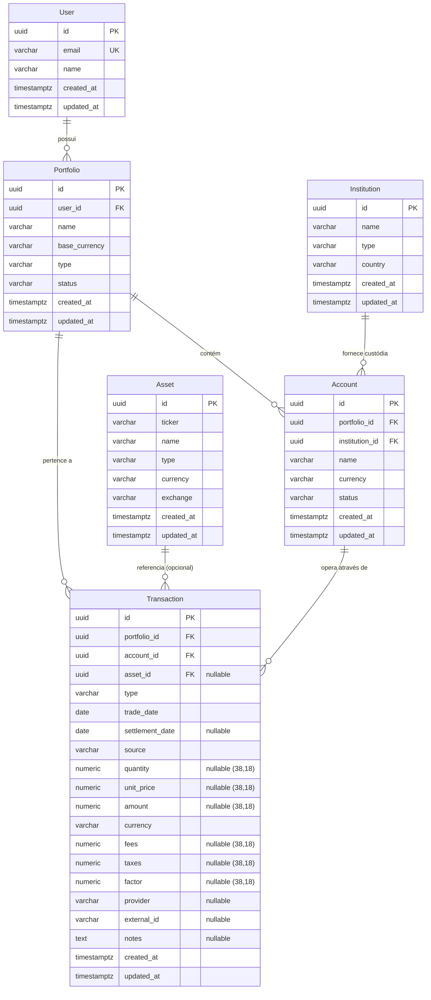

# Database Architecture — Project Atlas

## 1. Visão Geral

A camada de persistência do **Project Atlas** é implementada no pacote `@atlas/database` utilizando **PostgreSQL 16** e **Prisma ORM**.
Sua responsabilidade é armazenar de forma transacional (ACID), durável e precisa o modelo financeiro do sistema, com garantia de integridade referencial, preservação decimal absoluta e desacoplamento total em relação ao modelo de domínio (`@atlas/domain`).

---

## 2. Diagrama Entidade-Relacionamento (ER)



---

## 3. Especificação das Tabelas e Restrições

### 3.1 `users`

Modelo mínimo para garantir integridade referencial com carteiras. Não armazena dados de autenticação nesta fase.

- `id`: UUID (Chave Primária).
- `email`: VARCHAR(255) único (`users_email_key`).
- `name`: VARCHAR(255).
- `created_at` / `updated_at`: TIMESTAMPTZ(6).

### 3.2 `institutions`

Instituições financeiras (corretoras, bancos, custodiantes).

- `id`: UUID (Chave Primária).
- `name`: VARCHAR(255).
- `type`: VARCHAR(50) — `'BROKER'`, `'BANK'`, `'CUSTODIAN'`, `'OTHER'`.
- `country`: VARCHAR(2) — código ISO de país (ex.: `'BR'`, `'US'`).
- `created_at` / `updated_at`: TIMESTAMPTZ(6).

### 3.3 `portfolios`

Carteiras de investimento do usuário.

- `id`: UUID (Chave Primária).
- `user_id`: UUID referenciando `users(id)` com `ON DELETE CASCADE`.
- `name`: VARCHAR(255).
- `base_currency`: VARCHAR(3) — código ISO da moeda base (`'BRL'`, `'USD'`, `'EUR'`).
- `type`: VARCHAR(50) — `'PERSONAL'`, `'FAMILY'`, `'COMPANY'`, `'SIMULATION'`.
- `status`: VARCHAR(50) — `'ACTIVE'`, `'ARCHIVED'`.
- `created_at` / `updated_at`: TIMESTAMPTZ(6).
- **Índices:** `portfolios_user_id_idx`.

### 3.4 `accounts`

Contas de custódia vinculadas a uma carteira e a uma instituição.

- `id`: UUID (Chave Primária).
- `portfolio_id`: UUID referenciando `portfolios(id)` com `ON DELETE CASCADE`.
- `institution_id`: UUID referenciando `institutions(id)` com `ON DELETE RESTRICT`.
- `name`: VARCHAR(255).
- `currency`: VARCHAR(3).
- `status`: VARCHAR(50) — `'ACTIVE'`, `'ARCHIVED'`.
- `created_at` / `updated_at`: TIMESTAMPTZ(6).
- **Chave Única Composta:** `@@unique([id, portfolio_id])` — fundamental para a foreign key de proteção cross-portfolio na tabela de transações.
- **Índices:** `accounts_portfolio_id_idx`, `accounts_institution_id_idx`.

### 3.5 `assets`

Ativos financeiros negociáveis.

- `id`: UUID (Chave Primária).
- `ticker`: VARCHAR(50). Ticker normalizado em maiúsculas (ex.: `'PETR4'`).
- `name`: VARCHAR(255).
- `type`: VARCHAR(50) — `'EQUITY'`, `'FII'`, `'ETF'`, `'BDR'`, `'TREASURY_DIRECT'`, `'FIXED_INCOME'`, `'CRYPTO'`, etc.
- `currency`: VARCHAR(3).
- `exchange`: VARCHAR(50) — bolsa ou mercado (ex.: `'BVMF'`, `'NASDAQ'`, `'NYSE'`).
- `created_at` / `updated_at`: TIMESTAMPTZ(6).
- **Chave Única Composta:** `@@unique([ticker, exchange])`.
- **Índice:** `assets_ticker_idx`.

### 3.6 `transactions` (Transaction Ledger)

Tabela única discriminada para armazenar as 16 variantes do Ledger financeiro.

- `id`: UUID (Chave Primária).
- `portfolio_id`: UUID referenciando `portfolios(id)` com `ON DELETE CASCADE`.
- `account_id`: UUID referenciando `accounts(id)`.
- `asset_id`: UUID nullable referenciando `assets(id)` com `ON DELETE RESTRICT`.
- `type`: VARCHAR(50) — `'BUY'`, `'SELL'`, `'DIVIDEND'`, `'JCP'`, `'FII_INCOME'`, `'SPLIT'`, `'REVERSE_SPLIT'`, `'BONUS'`, `'SUBSCRIPTION'`, `'AMORTIZATION'`, `'TRANSFER_IN'`, `'TRANSFER_OUT'`, `'DEPOSIT'`, `'WITHDRAWAL'`, `'FEE'`, `'TAX'`.
- `trade_date`: DATE (`@db.Date`) — data civil da operação, sem fuso horário.
- `settlement_date`: DATE nullable (`@db.Date`) — data de liquidação civil.
- `source`: VARCHAR(50) — `'MANUAL'`, `'CEI'`, `'OPEN_FINANCE'`, `'BROKER_NOTE'`, `'IMPORT'`.
- `quantity`: NUMERIC(38, 18) nullable.
- `unit_price`: NUMERIC(38, 18) nullable.
- `amount`: NUMERIC(38, 18) nullable.
- `currency`: VARCHAR(3).
- `fees`: NUMERIC(38, 18) nullable.
- `taxes`: NUMERIC(38, 18) nullable.
- `factor`: NUMERIC(38, 18) nullable.
- `provider`: VARCHAR(100) nullable.
- `external_id`: VARCHAR(255) nullable.
- `notes`: TEXT nullable.
- `created_at` / `updated_at`: TIMESTAMPTZ(6).

#### Proteção Cross-Portfolio via Chave Estrangeira Composta

A restrição de chave estrangeira:

```sql
CONSTRAINT "transactions_account_id_portfolio_id_fkey"
  FOREIGN KEY ("account_id", "portfolio_id")
  REFERENCES "accounts"("id", "portfolio_id")
  ON DELETE RESTRICT ON UPDATE CASCADE;
```

Impede, a nível do engine relacional do PostgreSQL, que qualquer transação seja gravada vinculando uma conta pertencente à Carteira A com o `portfolio_id` da Carteira B. Violações disparam `CrossPortfolioIntegrityError`.

#### Idempotência de Transações Externas

```sql
CREATE UNIQUE INDEX "transactions_portfolio_id_provider_external_id_key"
  ON "transactions"("portfolio_id", "provider", "external_id");
```

Impede duplicidade de importações via Open Finance, CEI ou notas de corretagem para um mesmo evento externo dentro do portfólio. Múltiplas transações manuais com `provider` ou `external_id` nulos são perfeitamente aceitas.

#### Ordenação Determinística e Paginação

```sql
CREATE INDEX "transactions_portfolio_id_trade_date_created_at_id_idx"
  ON "transactions"("portfolio_id", "trade_date", "created_at", "id");
```

Garante consultas ao histórico financeiro com ordenação determinística garantida:
`ORDER BY trade_date ASC, created_at ASC, id ASC`.

---

## 4. Arquitetura de Acesso e Mapeamento

```text
[Domínio / Aplicação]
        ↓
[Interfaces de Repositório] (ex.: ITransactionRepository)
        ↓
[Implementação do Repositório] (ex.: TransactionRepository)
        ↓
[Mapeadores Bidirecionais] (TransactionMapper, DecimalConverter, DateConverter)
        ↓
[Prisma Client]
        ↓
[PostgreSQL 16]
```

### Regras de Conversão Numérica e Temporal

1. **Zero Float:** Números decimais no PostgreSQL (`NUMERIC(38,18)`) são convertidos para strings canônicas via `decimal.toString()` e passados diretamente para as factories `Money.from(...)` e `Quantity.from(...)`.
2. **Zero Deriva por Timezone:** As datas econômicas (`trade_date`, `settlement_date`) utilizam `DateConverter.toDomain(date)`, que extrai componentes em base UTC pura (`getUTCFullYear()`, `getUTCMonth() + 1`, `getUTCDate()`), eliminando distorções por horário de verão ou timezone do servidor.
3. **Isolamento de Tipos:** O pacote `@atlas/database` não re-exporta nenhum tipo nativo do `@prisma/client`.
