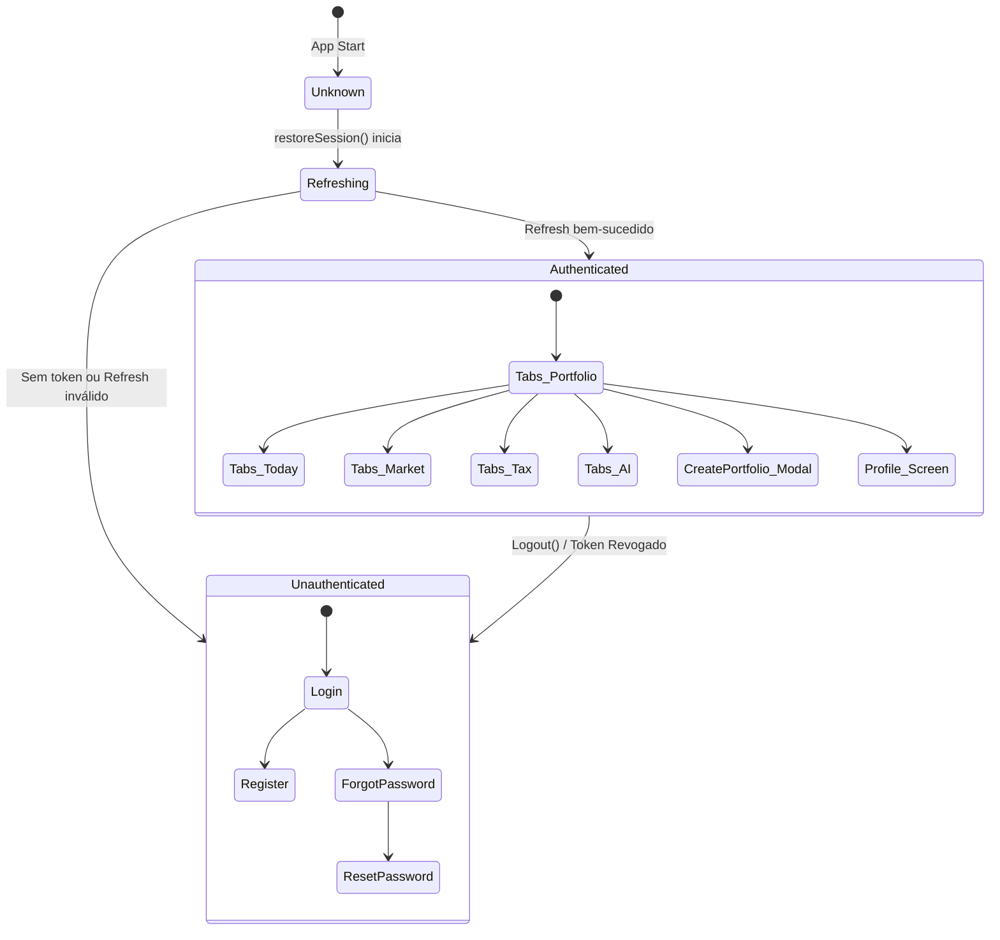
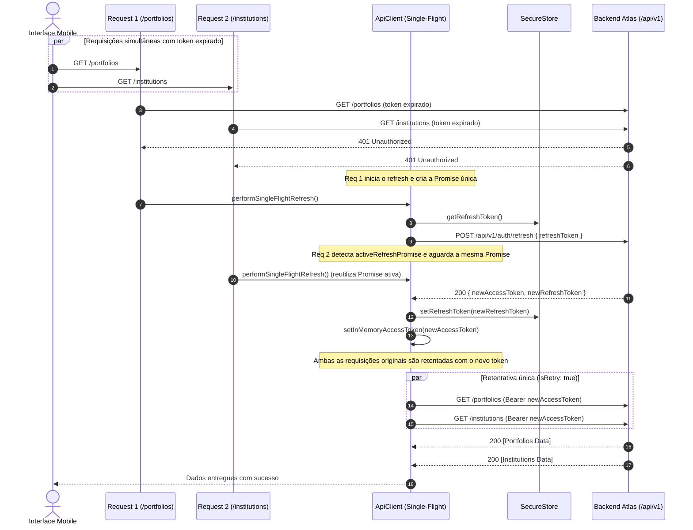

# Mobile Architecture — Project Atlas

## 1. Visão Geral

O aplicativo mobile do **Project Atlas** (`apps/mobile`) é construído sobre **Expo SDK 52** e **React Native 0.76**, utilizando **Expo Router v4** com roteamento baseado no sistema de arquivos, **TypeScript strict**, **Zustand** para estado de autenticação/sessão, **TanStack React Query v5** para gerenciamento de dados de servidor e **expo-secure-store** para armazenamento de credenciais criptografadas no hardware do dispositivo.

A arquitetura do mobile adota princípios de isolamento estrito de segurança, robustez de rede e desacoplamento visual:

- **Separação Rígida de Tokens:** O `refreshToken` rotativo reside exclusivamente no `expo-secure-store`. O `accessToken` reside exclusivamente em memória volátil. Nenhuma senha jamais é gravada.
- **Interceptor Single-Flight:** Concorrência transparente na renovação de tokens (401), multiplexando múltiplas requisições paralelas em uma única chamada de refresh e evitando falsas detecções de reuso.
- **Isolamento de Cache Cross-User:** Purga compulsória de cache do TanStack Query (`queryClient.clear()`) em qualquer logout ou expiração de sessão.
- **Design System Orientado a Tokens:** Componentes nativos (`Screen`, `Button`, `TextField`, `PasswordField`, `Card`, `EmptyState`, `ErrorState`, `LoadingState`, `OfflineBanner`, `Header`) consumindo as paletas e espaçamentos compartilhados de `@atlas/ui`.
- **Zero Cálculos Financeiros no Cliente:** Todo dado financeiro é puramente estrutural; motores de cálculo residem no domínio/backend.

---

## 2. Estrutura de Navegação e Rotas (Expo Router)

```text
apps/mobile/
├── app/
│   ├── _layout.tsx              # Root Layout: Provider, restauração de sessão e route guards
│   ├── (auth)/
│   │   ├── _layout.tsx          # Stack Layout para telas públicas de autenticação
│   │   ├── login.tsx            # Autenticação por e-mail e senha
│   │   ├── register.tsx         # Cadastro de novo usuário
│   │   ├── forgot-password.tsx  # Solicitação de recuperação anti-enumeração
│   │   └── reset-password.tsx   # Redefinição de senha com token
│   └── (app)/
│       ├── _layout.tsx          # Stack Layout autenticado (tabs, modais e telas filhas)
│       ├── (tabs)/
│       │   ├── _layout.tsx      # Bottom Tab Navigator com 5 abas principais
│       │   ├── today.tsx        # Aba 1: "Hoje" (resumo diário, eventos e fechamento)
│       │   ├── portfolio.tsx    # Aba 2: "Carteira" (listagem e gestão de carteiras)
│       │   ├── market.tsx       # Aba 3: "Mercado" (cotações e indicadores B3/Macro)
│       │   ├── tax.tsx          # Aba 4: "Fiscal" (controle de DARF e isenções)
│       │   └── ai.tsx           # Aba 5: "IA" (assistente contextual inteligente)
│       ├── create-portfolio.tsx # Modal: criação de carteira estrutural
│       └── profile.tsx          # Tela: perfil do investidor e logout seguro
```

### Máquina de Estados de Navegação no Root Layout



---

## 3. Segurança e Armazenamento Local

A política de armazenamento móvel segue estritamente a seguinte matriz de confidencialidade:

| Dado                   | Onde é Armazenado | Mecanismo                                                   | Persistência                       |
| :--------------------- | :---------------- | :---------------------------------------------------------- | :--------------------------------- |
| **Refresh Token**      | Hardware Seguro   | `expo-secure-store` (Keychain no iOS / Keystore no Android) | Persiste entre reinicializações    |
| **Access Token (JWT)** | Memória Volátil   | Variável JavaScript de módulo e Zustand Store               | Apagado quando o app fecha         |
| **User Profile**       | Memória Volátil   | Zustand Store (`useAuthStore`)                              | Reidratado via `/me` após refresh  |
| **Dados Financeiros**  | Cache em Memória  | TanStack Query Client (`queryClient`)                       | Purgado compulsoriamente no logout |
| **Senha**              | **NUNCA**         | **Nenhum** (proibido sob qualquer hipótese)                 | Nunca armazenado                   |

---

## 4. Cliente HTTP e Interceptor Single-Flight de Refresh

O cliente HTTP centralizado (`src/api/client.ts`) implementa a resiliência contra falhas de concorrência na expiração do token de acesso de 15 minutos:



### Prevenção de Loops Infinitos

- Se uma requisição já retentada (`isRetry: true`) receber 401 novamente, a execução é interrompida imediatamente sem tentar nova renovação.
- Caso o endpoint de `/refresh` retorne erro (401/403), a sessão é terminada imediatamente (`handleAuthFailure()`), limpando o `expo-secure-store`, esvaziando o cache e deslogando o usuário.

---

## 5. Gerenciamento de Estado de Servidor e Interface

### Estados Visuais Canônicos

Todas as telas conectadas a dados de servidor implementam os 4 estados obrigatórios:

1. **Carregando (`isLoading`):** Renderiza `<LoadingState message="..." />` com spinner e feedback visual acessível.
2. **Erro / Offline (`isError`):** Renderiza `<ErrorState message="..." onRetry={refetch} />`. Se `error.isOffline === true`, renderiza também o `<OfflineBanner />`.
3. **Vazio (`data.length === 0`):** Renderiza `<EmptyState title="..." description="..." actionTitle="..." onAction={...} />` instruindo o usuário sobre como dar os primeiros passos.
4. **Sucesso:** Renderiza a lista de cartões (`<Card />`) ou lista virtualizada (`<FlatList />`) com suporte a pull-to-refresh nativo.

### Isolamento Estrito de Cache entre Usuários

Ao invocar `useAuthStore.getState().logout()`, a função `clearQueryCache()` executa `queryClient.clear()`. Isso impede que o investidor B, ao realizar login no mesmo aparelho, visualize em tela dados ou nomes de carteiras previamente consultados pelo investidor A.

---

## 6. Verificação e Testes Automatizados

A suíte de testes do mobile é executada via:

```bash
pnpm test:mobile
```

Configuração isolada em `vitest.mobile.config.ts`, cobrindo:

1. `tests/mobile/secure-store.test.ts`: Validação de leitura/escrita e invariantes de segurança.
2. `tests/mobile/auth-store.test.ts`: Transições da máquina de estados, inicialização, reidratação e logout.
3. `tests/mobile/api-client.test.ts`: Multiplexação concorrente de 5 requisições em 1 único refresh, prevenção de loops 401 e detecção offline.
4. `tests/mobile/portfolio-flow.test.ts`: Busca de carteiras, criação estrutural e garantia de expurgo de cache cross-user.
5. `tests/foundation/mobile-security-rules.test.ts`: Regras estruturais impedindo `AsyncStorage` para tokens e exigindo chaves seguras.
