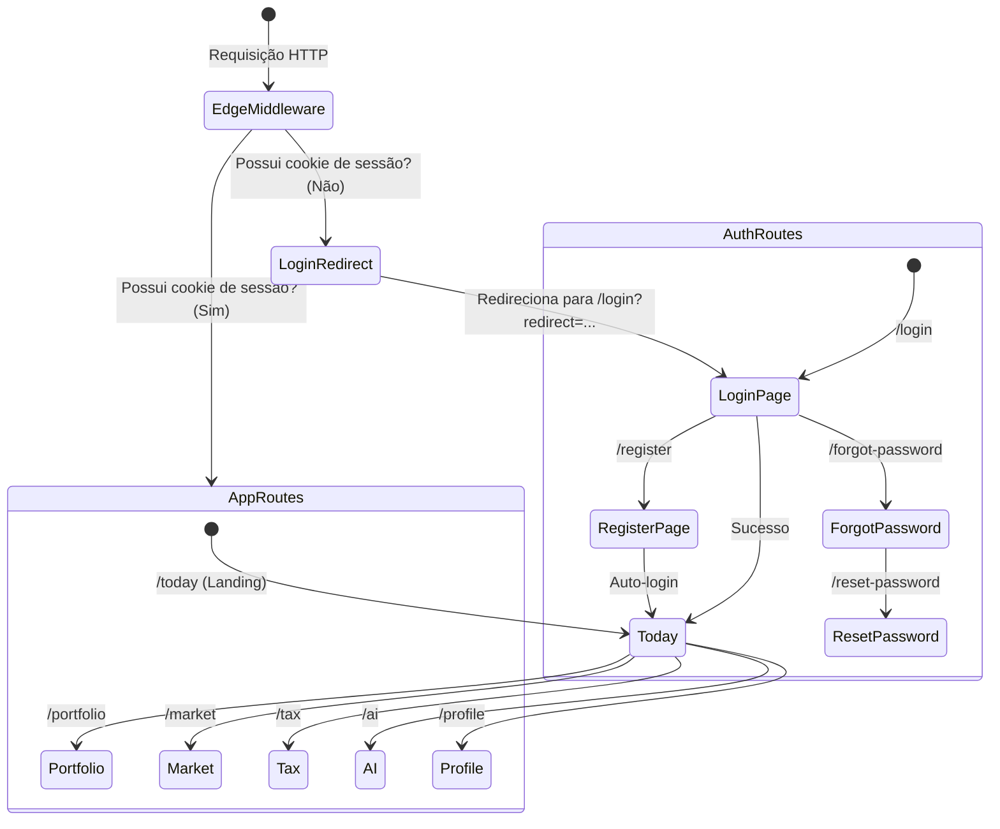
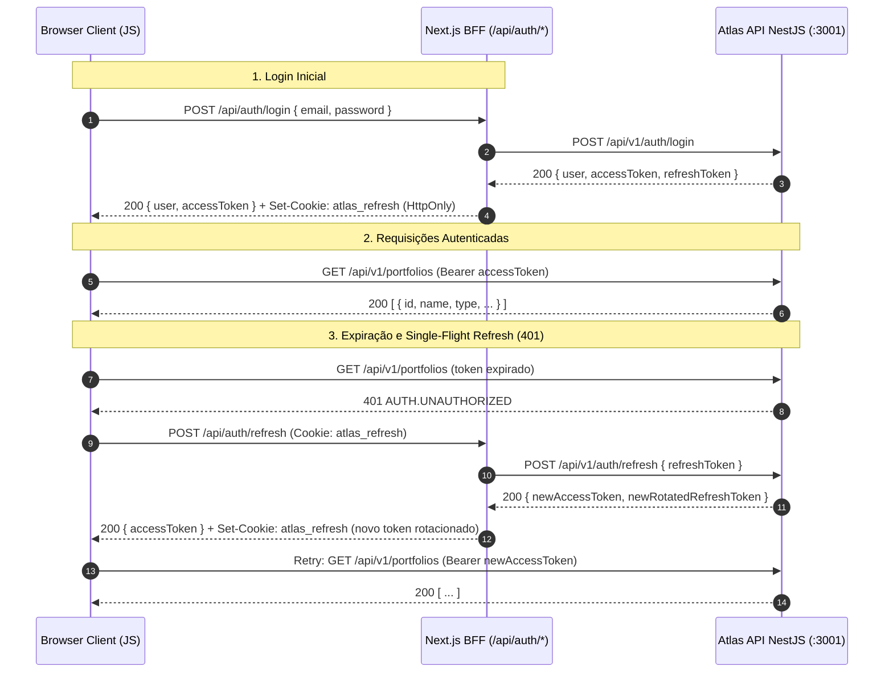

# Web Architecture — Project Atlas

## 1. Visão Geral

A aplicação web do **Project Atlas** (`apps/web`) é construída sobre **Next.js 15** (App Router) e **React 19**, utilizando **TypeScript strict**, **Zustand** para gerenciamento de estado de autenticação em memória, **TanStack React Query v5** para gerenciamento de estado de servidor e um modelo de segurança **Backend-for-Frontend (BFF)** com cookies seguros.

A arquitetura adota princípios inegociáveis de isolamento, segurança de credenciais e desacoplamento visual:

- **Zero Armazenamento de Tokens no Browser:** O `refreshToken` rotativo reside exclusivamente em cookies do servidor (`HttpOnly`, `SameSite=Lax`, `Path=/`, `Secure`). Código JavaScript em execução no navegador **nunca** tem acesso ao refresh token, eliminando superfícies de ataque por XSS.
- **Access Token em Memória Volátil:** O `accessToken` de curta duração reside unicamente na memória da aplicação (store Zustand e referência em escopo de módulo), sendo destruído imediatamente ao fechar a aba ou realizar logout.
- **BFF com Route Handlers Next.js:** O servidor Next.js atua como intermediário seguro (`/api/auth/*`), protegendo chamadas de rotação de token e expondo interfaces convenientes para a interface web.
- **Interceptor Single-Flight:** Concorrência transparente na renovação de tokens (401), multiplexando chamadas paralelas em uma única requisição ao `/api/auth/refresh` com o cookie HttpOnly.
- **Isolamento de Cache Cross-User:** Purga compulsória de cache do TanStack Query (`queryClient.clear()`) em qualquer encerramento de sessão ou detecção de 401 definitivo.
- **App Shell Responsivo Unificado:** Navegação por Sidebar e Header em resoluções Desktop e Bottom Navigation Bar em resoluções Mobile.
- **Zero Cálculos Financeiros no Cliente:** A web é estritamente estrutural e declarativa; toda matemática financeira e regras de negócio residem no domínio/backend.

---

## 2. Estrutura de Rotas (Next.js App Router)

```text
apps/web/src/
├── app/
│   ├── layout.tsx               # Root Layout: Providers (QueryProvider, AuthProvider) e estilos globais
│   ├── page.tsx                 # Root Page: Redirecionamento dinâmico (/today ou /login)
│   ├── api/                     # Backend-for-Frontend (BFF) Route Handlers
│   │   └── auth/
│   │       ├── login/route.ts           # Proxy de login: emite HttpOnly cookie e retorna accessToken
│   │       ├── register/route.ts        # Proxy de cadastro com auto-login e emissão de cookie
│   │       ├── refresh/route.ts         # Leitura do cookie HttpOnly, rotação upstream e re-emissão
│   │       ├── logout/route.ts          # Revogação de sessão upstream e purga de cookies
│   │       ├── me/route.ts              # Perfil do investidor autenticado
│   │       ├── forgot-password/route.ts # Recuperação de senha anti-enumeração
│   │       └── reset-password/route.ts  # Redefinição com token único
│   ├── (auth)/                  # Grupo de Telas Públicas de Autenticação
│   │   ├── layout.tsx           # Layout centralizado escuro com branding Atlas
│   │   ├── login/page.tsx       # Formulário de login com Suspense boundary
│   │   ├── register/page.tsx    # Formulário de criação de conta
│   │   ├── forgot-password/page.tsx # Solicitação de instruções
│   │   └── reset-password/page.tsx  # Redefinição de senha com token via query params
│   └── (app)/                   # Grupo de Telas Autenticadas (App Shell)
│       ├── layout.tsx           # App Shell: Sidebar Desktop, Header, Mobile Nav e OfflineBanner
│       ├── today/page.tsx       # Aba 1: "Hoje" (Landing autenticada, visão geral diária)
│       ├── portfolio/page.tsx   # Aba 2: "Carteira" (Listagem e criação de carteiras estruturais)
│       ├── market/page.tsx      # Aba 3: "Mercado" (Indicadores B3/Macro em preparação)
│       ├── tax/page.tsx         # Aba 4: "Fiscal" (DARF e limites de isenção em preparação)
│       ├── ai/page.tsx          # Aba 5: "IA" (Assistente inteligente contextual)
│       └── profile/page.tsx     # Tela de perfil do usuário e logout seguro
├── components/
│   └── ui/                      # Componentes visuais baseados nos tokens de @atlas/ui
│       ├── Button.tsx           # Botão com variantes, estado de loading e disabled
│       ├── Input.tsx            # Campo de entrada com rótulo e validação de erro
│       ├── Select.tsx           # Seleção com opções estilizadas
│       ├── Card.tsx             # Cartão de superfície com bordas padronizadas
│       ├── Badge.tsx            # Pílula de status e tipos de carteira
│       ├── Modal.tsx            # Janela modal acessível (WAI-ARIA) com backdrop
│       ├── Skeleton.tsx         # Bloco animado para carregamento estrutural
│       ├── EmptyState.tsx       # Estado de ausência de dados com call-to-action
│       ├── ErrorState.tsx       # Estado de falha com opção de retentativa
│       └── OfflineBanner.tsx    # Alerta visual reativo de desconexão de rede
├── lib/
│   ├── auth-cookie.ts           # Utilitários de serialização, parsing e opções seguras de cookies
│   ├── config.ts                # Configuração de URLs base da API e ambiente
│   └── react-query.ts           # Instância única do QueryClient e função de purga
├── providers/
│   ├── query-provider.tsx       # Provedor do TanStack Query
│   └── auth-provider.tsx        # Provedor de contexto de rede e restauração de sessão
├── stores/
│   └── auth.store.ts            # Máquina de estados Zustand (unknown, unauthenticated, authenticated, refreshing)
├── api/
│   ├── client.ts                # Cliente HTTP com interceptor single-flight e detecção offline
│   └── types.ts                 # Tipos tipados de API e DTOs de carteira
└── middleware.ts                # Next.js Edge Middleware de proteção perimetral de rotas
```

---

## 3. Máquina de Estados de Navegação e Proteção de Rotas



---

## 4. Fluxo de Autenticação Segura e Rotação de Tokens (BFF)



---

## 5. Estados Visuais Padronizados

Para garantir resiliência operacional, todas as telas de dados da web implementam obrigatoriamente cinco estados visuais estritos:

| Estado         | Componente      | Comportamento Visual                                                        |
| -------------- | --------------- | --------------------------------------------------------------------------- |
| **Carregando** | `Skeleton`      | Cards com animação de pulso no layout final antes da chegada dos dados      |
| **Vazio**      | `EmptyState`    | Mensagem amigável explicando ausência de registros + botão de ação primária |
| **Erro**       | `ErrorState`    | Alerta contextual claro com botão de ação para retentativa de requisição    |
| **Sucesso**    | Grid / `Card`   | Exibição limpa de dados, badges estruturais e metadados tipados             |
| **Offline**    | `OfflineBanner` | Faixa de aviso em topo de tela alertando sobre ausência de conexão          |

---

## 6. Comandos e Testes

- Executar testes unitários e de integração web:
  ```bash
  pnpm test:web
  ```
- Executar typecheck estrito:
  ```bash
  pnpm typecheck
  ```
- Executar build de produção do Next.js:
  ```bash
  pnpm build
  ```
