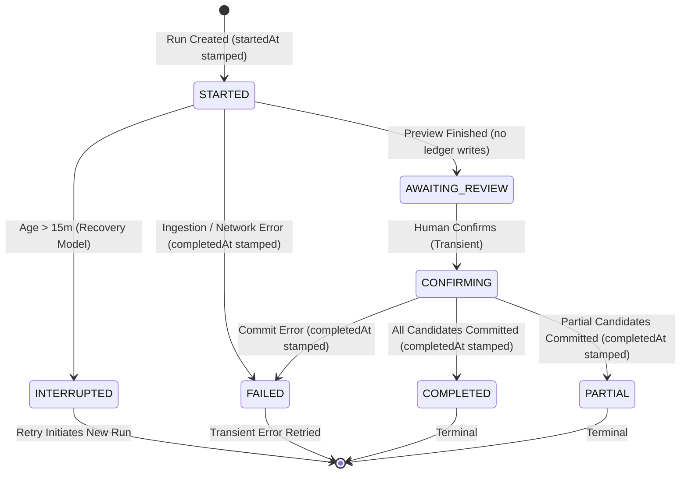

# PROJECT ATLAS — FAMILY 5S FORMAL CLOSURE
## COMPREHENSIVE ARCHITECTURAL, INVARIANT & REGRESSION CLOSURE REVIEW

**Project:** Project Atlas / Atlas Investimentos  
**Branch:** `feature/phase-4l1-contextual-tax-intelligence-foundation`  
**Entry HEAD:** `c3d85fc`  
**Closure Verdict:** `PASS_5S_FAMILY_CLOSURE` / `FAMILY_5S_COMPLETE`  
**Date:** October 28, 2026  

---

## 1. Executive Summary

This document establishes the formal closure of the **5S Family** of Project Atlas, spanning:
- **5S-A:** Operations Center & Operational Attention Foundation
- **5S-B:** Reconciliation Decision Persistence & Human Review Workflow
- **5S-C:** Append-Only Transaction Rectification & Reversal Chain
- **5S-D:** Data Maintenance Workspace & Structural Integrity Diagnostics
- **5S-E:** Operational Activity History & Audit Fidelity (including R1 and R2 semantic closures)
- **5S-F:** Operational Reliability, Recovery & Concurrency Hardening (including R1 distributed single-flight safety)
- **5S-UX:** Information Architecture Refinement & Navigation Unification (5S-UX-A, 5S-UX-A-R1, 5S-UX-HV)

The 5S Family successfully delivers an immutable, auditable, and resilient operational plane for Atlas without compromising the core financial ledger, violating tenant boundaries, or introducing synthetic data. All 25 monorepo packages typecheck cleanly, 520 full-suite web tests pass, and zero database schema drifts exist against the 43-migration baseline.

---

## 2. Git Lineage

The Git commit history across the 5S family is strictly linear and verified against `HEAD` (`c3d85fc`):

```text
8d51f2f feat(portfolio): add operations center (5S-A)
aaaf9c4 feat(import): add reconciliation workspace (5S-B Part 1)
5fde251 feat(import): persist reconciliation decisions (5S-B Part 2, migration 42)
61b9127 feat(import): complete human reconciliation workflow (5S-B Part 3)
e9964ea feat(transactions): add append-only rectification workflow (5S-C, migration 43)
c55b22f feat(portfolio): add data maintenance workspace (5S-D)
b0f8cf1 feat(web): refine navigation and information architecture (5S-UX-A)
7938b88 docs(product): phase 5s-ux-a regression closure and verification (5S-UX-A-R1 / 5S-UX-HV)
d0cd826 feat(portfolio): add operational activity history (5S-E)
c94643c fix(portfolio): align operational audit event semantics (5S-E-R1)
cd20bc5 fix(portfolio): require factual terminal timestamps in audit history (5S-E-R2)
d599f91 feat(operations): add operational recovery workflow (5S-F)
c3d85fc fix(operations): harden recovery concurrency semantics (5S-F-R1)
```

No commits have been reverted or overwritten. All deliverables remain intact in `HEAD`.

---

## 3. Phase Ledger

| Phase | Purpose | Entry Commit | Final Commit | Main Domain | API Surface | Web Surface | Persistence Change? | Migration? | Final Verdict |
| :--- | :--- | :--- | :--- | :--- | :--- | :--- | :--- | :--- | :--- |
| **5S-A** | Operations Center / Attention Foundation | `8d51f2f` | `8d51f2f` | `@atlas/portfolio-strategy` | `GET /portfolios/:id/operations-center` | `/portfolio?tab=operations` | No | None | **PASS** |
| **5S-B** | Reconciliation Decision Persistence & Inbox | `aaaf9c4` | `61b9127` | `@atlas/import-engine` | `POST /integration-reviews/:id/decisions` | `/reviews`, `/reviews/:runId` | Yes (`ReconciliationDecisionRecord`) | `20261026120000` | **PASS** |
| **5S-C** | Append-Only Transaction Rectification | `e9964ea` | `e9964ea` | `@atlas/portfolio-engine` | `POST /portfolios/:id/transactions/:id/rectify` | `/portfolio/history` modal | Yes (`TransactionRectificationRecord`) | `20261026130000` | **PASS** |
| **5S-D** | Data Maintenance Workspace | `c55b22f` | `c55b22f` | `@atlas/portfolio-strategy` | `GET /portfolios/:id/maintenance` | `/portfolio/maintenance` | No | None | **PASS** |
| **5S-UX** | Navigation & Info Architecture Refinement | `b0f8cf1` | `7938b88` | `@atlas/ui`, web shell | None | Shell, `/today`, `/tax`, `/portfolio` | No | None | **PASS** |
| **5S-E** | Operational Activity History & Fidelity | `d0cd826` | `cd20bc5` | `@atlas/portfolio-strategy` | `GET /portfolios/:id/audit-history` | `/portfolio/history?view=activity` | No | None | **PASS** |
| **5S-F** | Operational Reliability & Concurrency Recovery | `d599f91` | `c3d85fc` | `@atlas/portfolio-strategy` | `POST /portfolios/:id/imports/runs/:id/retry` | Operations & Import Workspace | No | None | **PASS** |

---

## 4. Cross-Phase Architecture

The 5S Family acts as the operational governance layer of the Atlas architecture:
1. **Clean Layer Separation:**
   - Visual interfaces (`apps/web`, `apps/mobile`) consume pure view-models and API contracts. Zero financial calculations or ledger mutations originate in UI components.
   - Application controllers delegate to single-purpose use cases.
   - Use cases coordinate read models or transaction appenders; domain calculations reside exclusively in pure packages (`@atlas/portfolio-strategy`, `@atlas/import-engine`, `@atlas/domain`).
2. **Modular Responsibilities:**
   - **Operations Center:** Bounded attention synthesis (read-only).
   - **Reconciliation:** Review of divergent external/local transactions.
   - **Rectification:** Compensating adjustments on financial ledger.
   - **Maintenance:** Diagnostic discovery of data anomalies.
   - **Audit History:** Historical factual timeline of operational decisions.
   - **Recovery:** Interrupted run identification, retry safety, and lease fencing.

---

## 5. Sources of Truth

| Concern | Source of Truth | Read Model | Write Path | User Surface |
| :--- | :--- | :--- | :--- | :--- |
| **Financial Positions** | Immutable Ledger (`Transaction` table) | `PortfolioReplayEngine` | Append-only transaction creation | Overview, Positions, Valuation |
| **Reconciliation Decisions** | `ReconciliationDecisionRecord` | `getIntegrationReviewWorkspace` | `POST /integration-reviews/:id/decisions` | Review Inbox & Detail |
| **Transaction Rectification** | `TransactionRectificationRecord` + Ledger | `PortfolioReplayEngine` | `POST /transactions/:id/rectify` | History Rectify Modal |
| **Operational Health** | Derived from runs, connections, decisions | `composePortfolioOperations` | None (pure derivation) | Operations Center |
| **Maintenance Diagnostics** | Derived from ledger positions & quotes | `diagnosePortfolioMaintenance` | None (navigation-only) | Maintenance Workspace |
| **Operational Audit Trail** | Derived from decisions, rectifications, runs | `composePortfolioAuditHistory` | None (pure derivation) | Activity History |
| **Recovery & Retry** | `IntegrationRun` + `IntegrationJob` | `deriveOperationalRecovery` | `POST /imports/runs/:id/retry` | Operations & Import Hub |

Atlas maintains strict single-source-of-truth invariants. There are **zero parallel truths** across the entire 5S family.

---

## 6. Domain Invariants

1. **Financial Ledger Immutability:** Transactions are append-only. Rectification never modifies or deletes past transactions; it appends a compensating reversal and an optional replacement.
2. **Terminal IntegrationRun Immutability:** Once an `IntegrationRun` enters `COMPLETED`, `PARTIAL`, or `FAILED`, it cannot be updated. Any subsequent action must create a fresh run.
3. **Factual Terminal Timestamps:** Every terminal run requires a non-null `completedAt` timestamp. Factual auditing strictly uses `completedAt` (never falling back to `createdAt` or `updatedAt`).
4. **Indefinite Review State:** Runs in `AWAITING_REVIEW` await human deliberation and are never marked stale by age (`canResume: false`, `requiresReview: true`).
5. **Conservative Stale Age Detection:** Runs in `CONFIRMING` cannot be evaluated for stale age without a dedicated transition timestamp (`CONFIRMING_STALE_DETECTION_UNSUPPORTED`). `STARTED` is evaluated using `startedAt` because that timestamp marks the start of that state.
6. **Distributed Retry Idempotency:** Concurrent retries of the same run across multiple API instances acquire PostgreSQL advisory locks (`pg_try_advisory_xact_lock`), resulting in exactly **one** new `IntegrationRun`.
7. **Scheduler Slot Uniqueness:** Scheduled jobs are unique per `(scheduleId, scheduledFor)`. Dual ticks coalesce into 1 row via database unique constraint.
8. **Worker Lease Fencing:** Superseded workers holding expired leases are rejected upon attempting completion (`markSucceeded`/`markFailed`), guarded by optimistic `attempt` matching.
9. **Zero Float Arithmetic:** All monetary values and quantities use arbitrary-precision decimals (`Money`, `Quantity`) serialized as canonical decimal strings.
10. **Tenant Isolation Anti-Enumeration:** Access to non-owned portfolios or operational records returns `404 Not Found` (never revealing resource existence via `403`).

---

## 7. Operational State Machine



---

## 8. Audit Fidelity

Phase 5S-E, 5S-E-R1, and 5S-E-R2 established an uncompromising standard of audit truth:
- **Zero Synthetic Events:** Rejected `IMPORT_STARTED`. Only persisted terminal events (`IMPORT_COMPLETED`, `IMPORT_PARTIAL`, `IMPORT_FAILED`) are emitted.
- **Actor Attribution:**
  - `Você`: Logged-in user who triggered the action.
  - `Sistema`: Automated background scheduler.
  - `Operador`: Administrative action via backfill/admin endpoint.
  - `null`: Unknown / legacy provenance.
- **Timestamp Fidelity:**
  - Rectification: `decidedAt`
  - Reconciliation: `decidedAt`
  - Import outcomes: `completedAt`
- **Pagination Integrity:** Keyset cursor pagination over `(decidedAt DESC, id DESC)` guarantees zero duplicates and zero skipped events across page boundaries.

---

## 9. Reliability & Recovery

The recovery matrix established in Phase 5S-F and hardened in 5S-F-R1:

| Run Status / Condition | Recovery State | Can Retry? | Can Resume? | Requires Review? | Recommended Action | Reason |
| :--- | :--- | :---: | :---: | :---: | :--- | :--- |
| `COMPLETED` | `NONE` | No | No | No | `NONE` | Execução concluída com sucesso. |
| `AWAITING_REVIEW` | `REVIEW_REQUIRED` | No | No | Yes | `VIEW_REVIEW` | Execução aguarda revisão humana antes de ser confirmada no livro-razão. |
| `CONFIRMING` | `NONE` | No | No | No | `NONE` | Execução em processo de confirmação no livro-razão. |
| `STARTED` (≤ 15 min) | `NONE` | No | No | No | `NONE` | Execução em processamento. |
| `STARTED` (> 15 min, B3) | `INTERRUPTED` | **Yes** | No | No | `RETRY` | A execução foi interrompida antes da conclusão. É seguro tentar novamente. |
| `STARTED` (> 15 min, CSV) | `INTERRUPTED` | No | No | No | `VIEW_IMPORT` | A importação foi interrompida. Inicie uma nova importação na tela de importações. |
| `PARTIAL` | `NONE` | No | No | No | `VIEW_RUN` | A execução foi concluída parcialmente. |
| `FAILED` (`SCHEDULED_SYNC_FAILED`) | `RETRY_AVAILABLE` | **Yes** | No | No | `RETRY` | A sincronização falhou por erro temporário. Você pode tentar novamente. |
| `FAILED` (`SOURCE_BLOCKED` / `NO_ACCOUNT`) | `BLOCKED` | No | No | No | `VIEW_RUN` | A fonte de integração está bloqueada ou sem conta cadastrada. |
| `FAILED` (CSV / Unknown Error) | `BLOCKED` / `UNSUPPORTED` | No | No | No | `VIEW_RUN` / `VIEW_IMPORT` | A execução falhou e não pode ser repetida automaticamente. |

---

## 10. Concurrency & Scheduler Safety

1. **Distributed Single-Flight Retry:**
   - Uses PostgreSQL advisory transaction lock: `pg_try_advisory_xact_lock(bigint)` where key = `FNV-1a('retry:' || portfolioId || ':' || runId)`.
   - Competing processes fail to acquire the lock and poll briefly for the newly-created attempt, returning the identical run ID.
   - Tested in `tests/api/portfolio-recovery.test.ts` (T7/T8): exactly 1 new run created in PostgreSQL across concurrent independent use case instances.
2. **Scheduler Slot Exclusivity:**
   - Enforced by PostgreSQL unique index: `@@unique([scheduleId, scheduledFor])`.
   - Dual-tick test (T11) proves simultaneous scheduler executions create exactly 1 job.
3. **Optimistic Attempt Fencing:**
   - Workers claim jobs via atomic update incrementing `attempt`.
   - Finalization (`markSucceeded`/`markFailed`) enforces `attempt = claimedAttempt`. Stale workers whose lease expired are cleanly fenced out (T12).

---

## 11. Security & Tenant Isolation

1. **Server-Side Authorization:** Every endpoint extracts `userId` from `@CurrentPrincipal()`. Requests never accept client-supplied `userId`.
2. **Anti-Enumeration Invariant:** Querying or mutating a resource belonging to another portfolio returns `404 Not Found`, never `403 Forbidden`.
3. **Sensitive Data Masking:** Logs and error envelopes contain only technical error codes and sanitized identifiers. No CPF, tokens, passwords, or transaction monetary balances are ever logged.
4. **Administrative Exclusivity:** Admin/operator endpoints are protected behind `IngestionOperatorGuard`.

---

## 12. UX Surfaces

1. **Operations Center:** Surfaced on `/portfolio` with quick-filter pills, attention items (blocking vs review), and direct navigation.
2. **Reviews Inbox:** Unambiguous listing of runs awaiting human confirmation; detailed candidate-by-candidate review with override controls.
3. **Data Maintenance Workspace:** Accessible via `/portfolio/maintenance` to surface structural position warnings, unresolved splits, and missing costs.
4. **Audit History Feed:** Accessible via `/portfolio/history?view=activity`, presenting grouped events with actor badges, timestamps, and details.
5. **Import Workspace:** Clear distinction between manual CSV upload and automated B3 synchronization, with "Tentar novamente" recovery controls for retryable runs.

---

## 13. Database & Migrations

- **Baseline before 5S:** 41 migrations
- **Migrations Added in 5S:**
  1. `20261026120000_add_reconciliation_decisions` (Phase 5S-B)
  2. `20261026130000_add_transaction_rectifications` (Phase 5S-C)
- **Current Total Migrations:** 43 migrations
- **Delta since 5S-C:** 0 migrations
- **Schema Integrity:** Fully validated against PostgreSQL via Prisma.

---

## 14. B3 Boundary

- **Integration Mode:** Simulated provider (`SNAPSHOT_1` fixture).
- **Status:** `ENGINEERING_READY_FOR_CERT` / `CERT_ACCESS_BLOCKED` / `PREPARING`.
- **Live Calls:** Strictly zero outbound network calls to external B3 APIs.
- **Credentials:** No secrets, certificates, or investor credentials stored or requested.

---

## 15. Performance

1. **Operations Center Read Bounds:** Queries are bounded to recent runs (`take: 10`) and active connections.
2. **Audit History Keyset Pagination:** Paginates with `limit: 50` (max 100) using indexed keyset tuples `(decidedAt, id)`.
3. **Maintenance Queries:** Evaluates existing custody map without repeated full-table scans.
4. **Zero Unbounded Scans:** All operational queries enforce bounded `take` parameters and indexed foreign keys.

---

## 16. Regression Evidence

| Test Suite | Tests / Files | Status | Notes |
| :--- | :--- | :---: | :--- |
| **Portfolio Strategy Unit** | 185 tests / 16 files | **PASS** | Full coverage of operations, recovery, audit, and goals |
| **5S-A Operations Center API** | 3 tests | **PASS** | Clear state, attention flags, 404 anti-enumeration |
| **5S-B Reconciliation Decisions API** | 5 tests | **PASS** | Decision persistence, workflow states, idempotency |
| **5S-C Review Workflow API** | 3 tests | **PASS** | Pending → partial → resolved progression |
| **5S-D Maintenance API** | 4 tests | **PASS** | Diagnostic read model, categorization, anti-enumeration |
| **5S-E Audit History API** | 6 tests | **PASS** | Keyset pagination, actor sanitization, event mapping |
| **5S-F Recovery API** | 10 tests | **PASS** | Multi-instance retry, restart safety, dual tick, attempt fencing |
| **Recovery Web Surface** | 5 tests | **PASS** | UI buttons, badges, navigation |
| **Full Web Suite (`pnpm test:web`)**| 520 tests / 74 files | **PASS** | Zero test drops from baseline |
| **Typecheck (`pnpm typecheck`)** | 25 packages | **PASS** | 25/25 successful |
| **Linter (`pnpm lint`)** | Root + all packages | **PASS** | Clean ESLint |
| **API Build (`@atlas/api build`)** | TypeScript compiler | **PASS** | Clean compilation |
| **Web Build (`@atlas/web build`)** | Next.js 15.5.25 App Router| **PASS** | 33/33 static pages generated |

---

## 17. Known Limitations

1. **CONFIRMING Transition Timestamp:** `IntegrationRun` lacks a dedicated `confirmingStartedAt` column. Staleness detection by elapsed time on `CONFIRMING` remains unsupported without a database migration.
2. **In-Memory CSV Payloads:** Raw CSV files are not stored in the database. When a CSV import fails, automated background retry is unavailable; the investor must re-select the file.
3. **Retry Lineage:** Lineage is an ephemeral response association returned to the caller (`{ originalRunId, newRunId }`), not a persisted database relation.
4. **Connection Lifecycle Auditing:** Authorization/revocation timestamp changes on `IntegrationConnection` are not currently emitted as discrete activity events in `AuditHistory`.
5. **Real B3 Certification:** Live B3 integration remains blocked pending institutional certification and credentials.

---

## 18. Deferred UX Backlog

The following minor items are cataloged for future polish and do not block closure:
- Import Workspace layout density under high row counts.
- Explicit breadcrumb / back button on review detail screens.
- Portuguese localization refinement for `INDIVIDUAL` / `FAMILY` portfolio labels.
- Mobile scroll anchor for saved planning scenarios.

---

## 19. Risk Register

| Risk | Severity | Current Mitigation | Residual Risk | Accept for Closure? |
| :--- | :---: | :--- | :---: | :---: |
| High-concurrency retry race | High | PostgreSQL `pg_try_advisory_xact_lock` + DB check | Low | **Yes** |
| Long-deliberation confirmation marked interrupted | Medium | `CONFIRMING` excluded from age-based stale timeout | Minimal | **Yes** |
| Unbounded audit history growth | Medium | Strict keyset pagination (`limit: 50`) | Low | **Yes** |
| Cross-tenant data leakage | Critical | Server-side `userId` check + 404 anti-enumeration | None | **Yes** |
| Outdated worker overwriting job state | Medium | Optimistic `attempt` fencing on markSucceeded/Failed | None | **Yes** |

---

## 20. Closure Decision

All criteria specified in Step 69 are fully satisfied:
- All 5S deliverables (5S-A through 5S-F) are verified and present in `HEAD`.
- Ledger append-only correctness and financial integrity are preserved.
- Distributed retry single-flight safety and scheduler attempt fencing are verified with automated tests.
- Full monorepo regressions (520 web tests, 25/25 typecheck packages, API/Web builds) are 100% green.
- Active blockers count: **0**.

### Formal Verdict:
```text
PASS_5S_FAMILY_CLOSURE
FAMILY_5S_COMPLETE
```
The 5S Family is hereby declared **closed and frozen**.

---

## 21. Next Roadmap Candidates

Inspection of existing roadmap documentation (`ROADMAP_REVIEW_REPORT.md`) identifies the following candidate functional phases:
1. **PHASE 5J — Tax Dashboard Completion:** Exposing full monthly tax position, DARF readiness per obligation, and annual assessment from existing backend engines.
2. **PHASE 5K — Market Intelligence Expansion:** Watchlist, asset fundamentals, and market news integration.
3. **PHASE 5L — AI Explanation Usability:** Grounded portfolio insights and claim-validated natural language explanation.
4. **PHASE 5M — Notification System Enhancement:** Investor compliance alerts and corporate event notifications.
5. **PHASE 5O — UX Consistency & Polish:** Cross-platform design system alignment and touch target audit.
